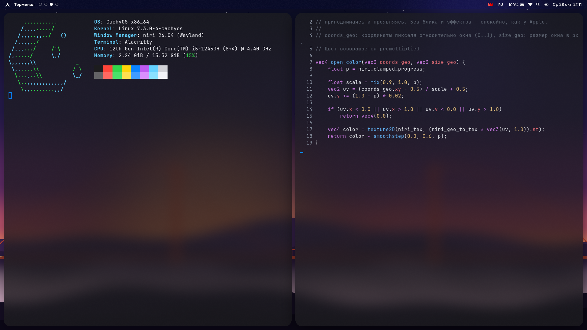
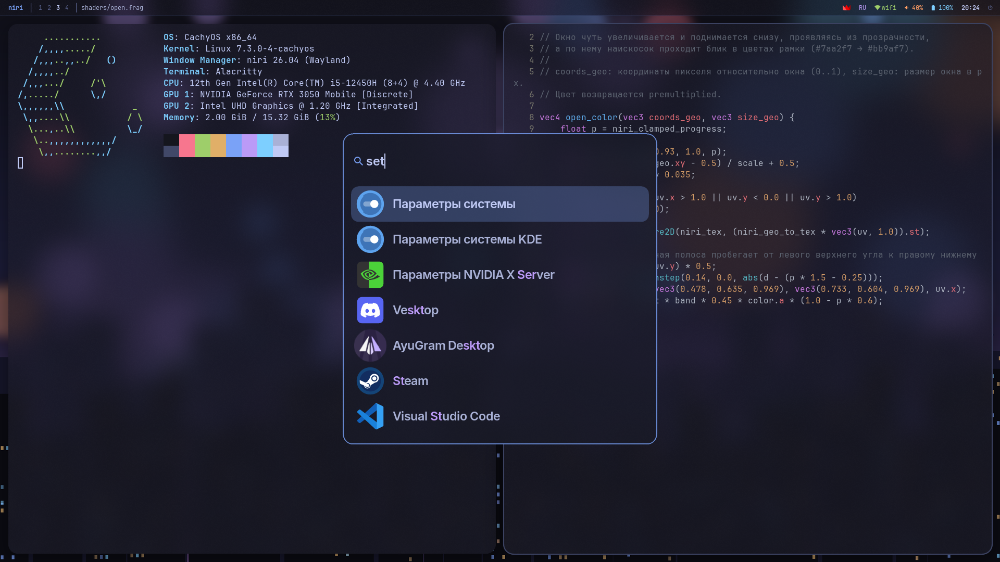
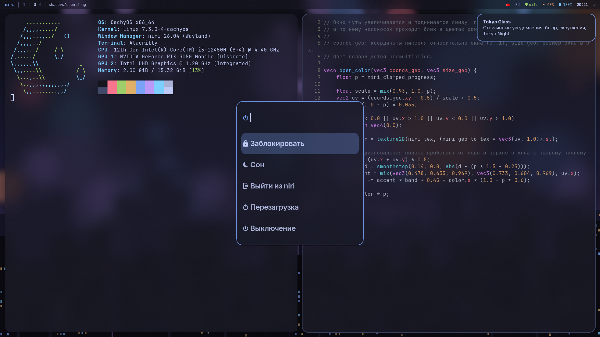

# giga-niri

Оформление для [niri](https://github.com/niri-wm/niri) 26.04 в стиле **Tokyo Glass**: палитра Tokyo Night, матовое стекло, блюр, градиентные рамки и собственные шейдерные анимации.

Сделано для CachyOS/Arch рядом с KDE Plasma: всё применяется только внутри сессии niri и не меняет темы KDE, GTK и Qt.



| Лаунчер | Меню питания и уведомления |
|---|---|
|  |  |

## Что внутри

- **Стекло.** Полупрозрачные окна и панели с блюром niri 26.04. По умолчанию xray-блюр (размывает обои, считается один раз), у лаунчера настоящий.
- **Рамка фокуса** с градиентом `#7aa2f7 → #bb9af7`, общим на весь экран: переливается при прокрутке колонок.
- **Анимации.** Пружины с лёгким отскоком; свои GLSL-шейдеры: окно проявляется с бликом и рассыпается на светящиеся квадратики при закрытии.
- **Обои** «ночной город и боке», нарисованы скриптом ([scripts/make-wallpaper.py](scripts/make-wallpaper.py)), без проблем с лицензией.
- **Бар** waybar: рабочие столы, заголовок окна, трей, раскладка, Wi‑Fi, звук, батарея, часы с календарём.
- **Лаунчер** fuzzel, **уведомления** mako, **меню питания** на fuzzel с подтверждением.
- **Блокировка** hyprlock: размытые обои, часы, поле пароля с градиентной рамкой.
- **Питание как в KDE** (hypridle + [giga-niri/idle.sh](giga-niri/idle.sh)): на зарядке экран не гаснет и ноутбук не засыпает, в том числе при закрытой крышке ([giga-niri/lid-inhibit.sh](giga-niri/lid-inhibit.sh)); от батареи экран приглушается через 10 минут и гаснет через 30.

## Клавиши

`Mod` — клавиша Super (Win). Полный список: `Mod+Shift+/` — своя подсказка на fuzzel в стиле лаунчера ([giga-niri/keybinds.py](giga-niri/keybinds.py)), строится из `binds.kdl`, Enter выполняет действие.

| Клавиши | Действие |
|---|---|
| `Mod+Return` | Терминал (alacritty с конфигом giga-niri) |
| `Super` (одиночное нажатие) | Открыть / закрыть лаунчер (нужна группа `input`, см. ниже) |
| `Mod+D` | Лаунчер |
| `Mod+E` / `Mod+B` | Файлы / браузер |
| `Mod+O` | Overview |
| `Mod+Q` | Закрыть окно |
| `Mod+Shift+Q` | Меню питания |
| `Super+Alt+L` | Заблокировать |
| `Meta+Space` | Раскладка us/ru |
| `Ctrl+Alt+Delete` | Аварийный выход из niri |
| `Mod+Shift+Return` | Аварийный терминал с обычным конфигом alacritty |

## Установка

Пакеты:

```sh
sudo pacman -S --needed niri xwayland-satellite waybar fuzzel mako awww \
    alacritty inter-font ttf-jetbrains-mono-nerd brightnessctl playerctl \
    hyprlock hypridle qt5-wayland
```

Конфиги ставятся симлинками в `~/.config`. Установщик пишет только в папки из белого списка (`niri`, `waybar`, `fuzzel`, `mako`, `giga-niri`, `xdg-desktop-portal/niri-portals.conf`), существующие переносит в `~/.config/niri-themes-backup/`:

```sh
git clone https://github.com/shaurma228/giga-niri ~/giga-niri
cd ~/giga-niri
scripts/check-kde.sh --snapshot   # снимок настроек KDE до установки
scripts/install.sh                # или выборочно: scripts/install.sh niri waybar
```

Откат: `scripts/uninstall.sh`.

Конфиг рассчитан на конкретный ноутбук (мониторы, путь к render-узлу NVIDIA, иконки Tela). Перед установкой на другой машине поправьте `niri/cfg/outputs.kdl` и `niri/cfg/misc.kdl`.

### Лаунчер по одиночному Super

niri 26.04 вызывает бинды в момент нажатия, поэтому бинд на голый `Super_L` срабатывал бы и при `Super+D`. [giga-niri/super-tap.py](giga-niri/super-tap.py) сам читает `/dev/input` и считает «тапом» нажатие Super без других клавиш и кнопок мыши короче 400 мс. Для этого пользователь должен быть в группе `input` (`sudo usermod -aG input $USER` и перезаход); без неё скрипт сразу выходит. Учтите: группа `input` даёт программам пользователя читать нажатия клавиш напрямую.

## Совместимость с KDE

- Темы GTK/Qt, `kdeglobals`, dconf не трогаются. Переменные окружения задаются в блоке `environment {}` niri и действуют только в его сессии.
- У alacritty в niri свой конфиг, который подключает ваш обычный и переопределяет поверх него только тему.
- Секреты в обеих сессиях хранит KWallet: для niri портал Secret переключён на kwallet (`xdg-desktop-portal/niri-portals.conf`). `gnome-keyring` ставить не нужно.
- `scripts/check-kde.sh` сравнивает настройки KDE/GTK/Qt/dconf со снимком; `install.sh` запускает его до и после установки.

## Структура

```
niri/              config.kdl + cfg/*.kdl; animations.kdl собирается из animations.kdl.in
shaders/           GLSL открытия и закрытия окон
waybar/ fuzzel/ mako/
giga-niri/         alacritty, hyprlock, hypridle, меню питания, обои (симлинк)
wallpapers/        сгенерированные обои
scripts/           install, uninstall, check-kde, gpu-bench, make-wallpaper, build-animations
```

Шейдеры: niri 26.04 не умеет `custom-shader path=`, поэтому после правки `shaders/*.frag` нужно `python3 -I scripts/build-animations.py`.

## Производительность

Intel UHD (Alder Lake-P, 48 EU), 1920×1080 @ 144 Гц, замер `scripts/gpu-bench.sh` без root:

| Сценарий | Загрузка iGPU | Средняя частота |
|---|---|---|
| Анимации без эффектов | 30.5% | 96 МГц |
| Стекло, тени, градиент, обои | 37.4% | 114 МГц |
| + пружины и шейдеры | 42.7% | 120 МГц |
| Открытие/закрытие окон по кругу | 31.2% | 132 МГц |

Частота далека от максимума 1200 МГц, NVIDIA для оформления не нужна: niri её не открывает (`ignore-drm-device`), игры запускаются через `prime-run`.

Подробный план и журнал решений: [PLAN.md](PLAN.md).
